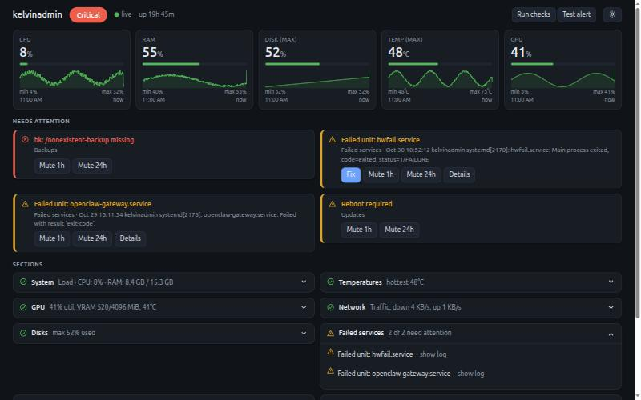

# homelab-watch

A small health monitor for your own Linux machine or home server.

It watches things like CPU, memory, disks, temperatures, the GPU, Docker containers and
systemd services. It shows them on a live web page, remembers the last 30 days, and pings you
(Discord, Telegram or any webhook) when something breaks, and again when it recovers. If you
choose, it can also restart a crashed service for you, but only the ones you list.

It is one Python program with **no dependencies**: no pip, no database server, no JavaScript
libraries, no internet needed.



## What it is, in plain words

Think of it as a smoke detector for your server.

- **It looks around** every few seconds: is the CPU busy, is a disk nearly full, is the GPU hot,
  did a container die, can I reach my router, does my website still answer, is last night's
  backup too old?
- **It shows you** the answer on a dashboard. Healthy things stay quiet and folded away. Only
  problems get a card at the top, so you see what matters in one glance.
- **It tells you** when something goes wrong. It waits for the problem to last for a minute
  before bothering you (so a brief temperature spike does not wake you up), and it never repeats
  itself every few minutes.
- **It can fix simple things**, if you allow it. It only ever runs a short, fixed list of
  commands (restart this unit, restart that container, clean some disk space) and only on names
  you wrote in the config. It gives up after 3 tries and asks a human.

## What you need

- Linux (built and tested on Ubuntu 24.04) and **Python 3.11 or newer**
- Optional, used if present, skipped quietly if not: `docker`, `nvidia-smi`, `systemctl`,
  `journalctl`, `ping`, `apt-get`

## Install

There is nothing to install in the pip sense. Get the folder and run it.

```bash
git clone https://github.com/VinsOrl/_se.git
cd _se/week8/homelab-watch
bin/hw report          # try it right now, no setup needed
```

To type just `hw` from anywhere, put the `bin/` folder on your PATH or link it:

```bash
ln -s "$PWD/bin/hw" ~/.local/bin/hw
```

(`python3 -m hw ...` from this folder works too.)

## Set it up (about 3 minutes)

```bash
hw init                # writes ~/.config/homelab-watch/config.toml with comments
nano ~/.config/homelab-watch/config.toml     # add what you want to watch
hw install-service     # runs `hw serve` in the background, restarts it if it crashes
```

Then open **http://127.0.0.1:8765**. That is the whole setup: one process does everything
(live checks, history, alerts, dashboard).

Want to try it without installing anything? Run `hw serve` in a terminal and press Ctrl-C to stop.

To keep it running after you log out: `loginctl enable-linger $USER`.
To remove it: `hw uninstall` (your config and history are kept).

## Using it

| Command | What it does |
|---|---|
| `hw report` | Prints a health report (add `-o file.md` to save it, `--format json` for JSON) |
| `hw check` | Prints only the problems. Exit code 0 = fine, 1 = warning, 2 = critical (good for scripts) |
| `hw serve` | Runs the live engine and dashboard (default `127.0.0.1:8765`, change with `--host`, `--port`) |
| `hw install-service` | Installs `hw serve` as a systemd **user** service (no sudo) |
| `hw init` | Writes a commented default config |
| `hw test-alert` | Sends a test message to your alert targets |
| `hw fix-log` | Shows what self-heal did (or would have done) |
| `hw collect [--alert] [--fix]` | Takes one sample and stores it. A headless alternative to `serve` |
| `hw install-timer` | Headless alternative: a timer that runs `hw collect --alert` every 5 minutes |
| `hw uninstall` | Removes the systemd units |

### The dashboard

- **Top bar**: hostname, a big status pill (OK / N warnings / Critical), a dot that pulses green
  while the live connection works and turns amber if it falls back to polling, uptime, a light/dark
  switch.
- **Tiles** for CPU, RAM, disk, temperature and GPU, each with a bar and a 24 hour sparkline.
  Hover for exact values, click for a bigger chart (1h / 6h / 24h / 7d).
- **Needs attention**: one card per problem, with buttons:
  - **Fix**: run the allowed fix (only in `ask` mode, see below)
  - **Mute 1h / 24h**: keep it on screen but stop alerts and auto-fix for a while
  - **Details**: show the last log lines (with a copy button)
- **Sections** (System, Disks, Docker, Network, ...) are collapsed to one line when healthy,
  like "Docker: 9 running, 1 exited". Open one to see more, or "Show all".
- **Run checks / Test alert** buttons at the top, and a **Fix log** drawer once something was fixed.

The buttons that change things need a token. `hw init` creates one in the config
(`[remediation] token`); the page asks for it once per browser tab. Those buttons only work
from the same machine.

> **Security note:** the dashboard has no login. It listens on `127.0.0.1` by default, which
> means only your own machine can open it. If you want to reach it from elsewhere, put it behind
> a reverse proxy or use Tailscale rather than binding it to the open network.

## Configuration

`hw init` writes a fully commented file at `~/.config/homelab-watch/config.toml`. Everything is
optional. A small example:

```toml
[thresholds]
disk_warn = 80            # warn above 80% full (default 85, critical default 95)

[checks]
ping = ["1.1.1.1"]
dns = ["example.com"]
ignore_containers = ["hello-world-test"]

[[checks.http]]
name = "grafana"
url = "http://localhost:3000/api/health"
expect = 200
fix_container = "grafana"      # optional: what self-heal may restart if this fails

[[checks.tcp]]
host = "localhost"
port = 5432

[[checks.backup]]
name = "nightly"
path = "/mnt/backup/latest"
max_age_hours = 26

[alerts]
cooldown_minutes = 30
min_samples = 2                # must be bad this many checks in a row before it alerts
[alerts.discord]
webhook_url_env = "HW_DISCORD_URL"   # or webhook_url = "..." directly
```

Each check ends up as `ok`, `warn` or `crit`. Metrics have two thresholds (for example disk
85 / 95). A failed ping, DNS, HTTP or TCP check counts as `crit`.

### How often things run (`[engine]`)

| Speed | Default | What |
|---|---|---|
| fast | 2 s | CPU, load, RAM/swap, temperatures, GPU, network speed |
| medium | 30 s | disks, Docker, failed units, ping/DNS/HTTP/TCP, top processes |
| slow | 10 min | pending apt updates, reboot needed, backup age |

History is saved every 60 s and kept for 30 days (`[history] retention_days`).

## Alerts

Supported: **Discord webhook**, **Telegram bot**, or a **generic JSON webhook**.

You get a message when a check turns bad, and one when it is OK again. In between, silence.
A short flicker never sends anything, and the cooldown stops a flapping check from spamming you.
Secrets can come from environment variables (`*_env` keys) instead of the file, and `hw` warns
you if your config file is readable by other users (`chmod 600` it; `hw init` does).

Use `hw test-alert` to check that your target works.

## Self-heal (optional, off by default)

```toml
[remediation]
enabled = false           # switch on when you are ready
mode = "dry-run"          # dry-run | ask | auto
fix_units = ["grafana-server.service"]
fix_containers = ["grafana"]
```

| Mode | What happens |
|---|---|
| `dry-run` | Only writes "I would run X" to the fix log. Start here. |
| `ask` | The dashboard shows a **Fix** button; nothing runs until you click it. |
| `auto` | It runs the fix itself, waits, re-checks, and logs the result. |

The full list of things it is allowed to run:

- `systemctl --user restart <unit>` (user services), or `sudo -n systemctl restart <unit>` (system services)
- `docker restart <container>`
- only when a disk is critically full: `apt-get clean`, `journalctl --vacuum-time=7d`, `docker image prune -f`

Targets must be in your config. It never reboots, deletes your files, edits config, kills random
processes or runs anything else. After 3 failed tries in an hour it stops and sends one "needs a
human" alert. Every action is saved to the fix log, and alerts say what was tried and what happened.

System-level restarts need a narrow sudo rule (never blanket sudo). Create
`/etc/sudoers.d/homelab-watch` with `sudo visudo -f`, replacing `youruser` and the units:

```
youruser ALL=(root) NOPASSWD: /usr/bin/systemctl restart grafana-server.service, \
    /usr/bin/apt-get clean, /usr/bin/journalctl --vacuum-time=7d
```

## Where things live

| What | Where |
|---|---|
| Config | `~/.config/homelab-watch/config.toml` |
| History + fix log + mutes | `~/.local/share/homelab-watch/history.db` (SQLite) |
| Service file | `~/.config/systemd/user/hw-serve.service` |
| Logs when running as a service | `journalctl --user -u hw-serve` |

## Project layout

```
bin/hw                 launcher
hw/collectors.py       all checks and metrics, config loading, report text
hw/engine.py           the live loops (fast / medium / slow) and shared snapshot
hw/store.py            SQLite: history, fix log, alert state, mutes, lock file
hw/alerts.py           Discord / Telegram / webhook, state change + cooldown
hw/fix.py              the allowlisted self-heal
hw/server.py           web server, live events, API
hw/page.html           the dashboard (one file, no libraries)
hw/cli.py              the `hw` commands
tests/                 unit tests
docs/                  screenshots
REPORT.md              build notes, review findings, decisions
```

## Tests

```bash
python3 -m unittest
```

## Troubleshooting

- **"another `hw serve` is already running"**: only one can run at a time (so alerts are never
  sent twice). Stop the other one, or `systemctl --user stop hw-serve`.
- **Docker section missing**: your user probably is not in the `docker` group. The report
  says so in its notes.
- **Temperature alerts every few minutes**: sensors sitting near the limit. Raise
  `temp_warn` / `temp_crit`, or increase `min_samples`.
- **`hw collect --alert` does nothing**: that is intended while `hw serve` is running.
- **Buttons on the page are missing**: they need a token in the config and the page opened from
  the same machine.

## Not included (on purpose)

One machine only: no multi-host, no user accounts, no cloud, no Docker image, no pip package,
no plugins. It is meant to stay small.
